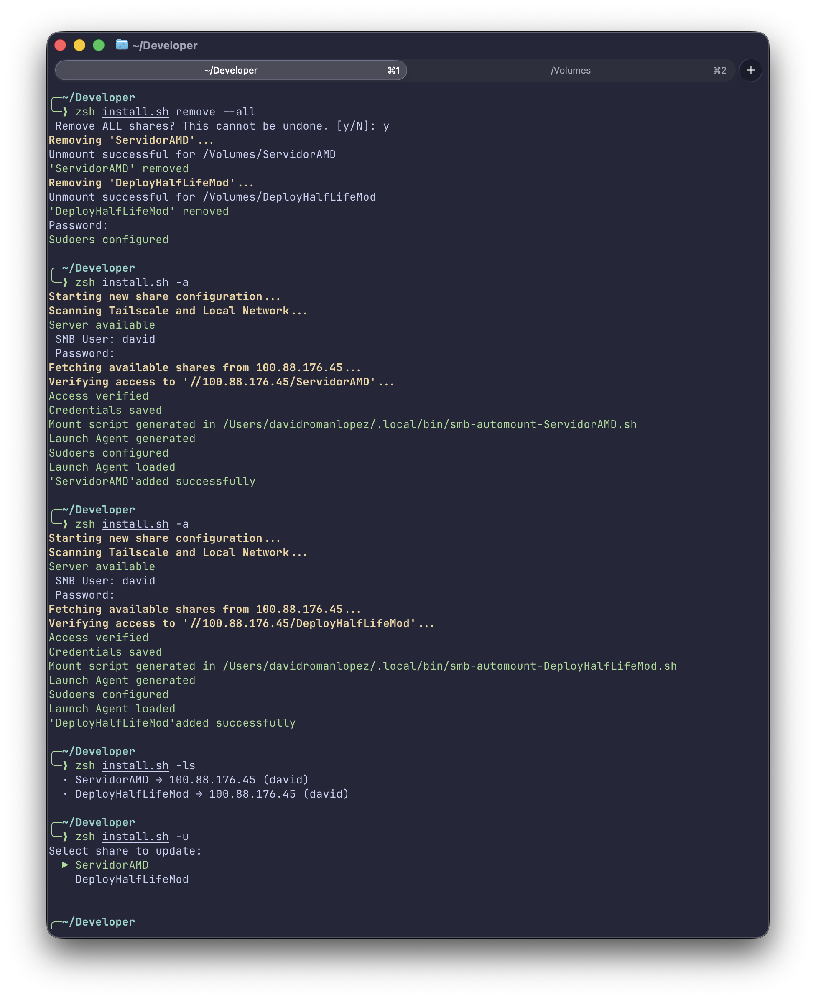

# smb-automount

> Persistent, reliable SMB auto-mounting for macOS.

macOS forgets your mounted network volumes every time your laptop sleeps, wakes or loses the connection. smb-automount registers each share as a LaunchAgent that remounts it whenever the volume goes missing.

## Why this exists

I made this tool because every single time I closed my MacBook lid I had to enter the user and password for every SMB volume again, in Finder with ⌘K (`smb://host/share`). I thought the OS should handle that automatically, so I decided to do it myself.

The script takes care of the whole lifecycle:

- Saves credentials in the macOS Keychain, never in plain text
- Generates a mount script per share that gets the password from the Keychain and mounts the volume
- Waits for the network after sleep or a VPN reconnect without hanging Finder
- Removes stale mount points (ghost folders) that break normal mounting
- Uses a lock so shares from the same server mount one at a time instead of colliding
- Gives you a simple CLI to add, update, list or remove shares at any time

## Requirements

- macOS (tested on macOS Tahoe 26.5)
- Zsh (default shell since macOS Catalina)
- Network access to your SMB server
- Tailscale (optional): the tool was made for local networks and Tailscale, so it's recommended

## Installation

### Homebrew (recommended)

```zsh
brew tap davidrlopez/tap
brew install smb-automount
```


### Manual

```zsh
git clone https://github.com/davidrlopez/smb-automount.git
cd smb-automount
chmod +x smb-automount
./smb-automount -a
```

`add` (`-a`) asks for:

| Prompt      | Description                                                        |
| ----------- | ------------------------------------------------------------------ |
| SMB User    | Your SMB username                                                  |
| Password    | Stored in the Keychain, never written to disk                      |
| Server IP   | IP address or hostname of your SMB server                          |
| Volume name | The volume name as it appears in `/Volumes/` (e.g. `NAS`, `Media`) |

## Usage

```zsh
smb-automount [command]
```

| Command        | Alias      | Description                                                      |
| -------------- | ---------- | ---------------------------------------------------------------- |
| `add`          | `-a`       | Add a new SMB share and register it as a LaunchAgent             |
| `remove`       | `-r`       | Remove a share, its agent, and its keychain entry                |
| `remove --all` | `-r --all` | Remove all configured shares                                     |
| `list`         | `-ls`      | List all configured shares                                       |
| `update`       | `-u`       | Update credentials or host for an existing share                 |
| `uninstall`    | `-un`      | Remove everything: agents, scripts, config and the sudoers entry |
| `help`         | `-h`       | Show usage                                                       |



## How it works

When you add a share, the tool:

1. Looks for SMB hosts on the local network (mDNS, `.local`) and on Tailscale (`100.x.x.x`).
2. Stores the credentials in the macOS Keychain (`security add-generic-password`).
3. Generates a script in `~/.local/bin/` that:
   - checks whether the volume is already mounted (exact match)
   - takes a lock (`/tmp/smb-automount.lock`) so shares mount one by one and the server doesn't reject them
   - cleans up ghost folders in `/Volumes` before mounting
4. Registers a LaunchAgent that runs that script every 15 seconds.

### File layout

```
~/.config/smb-automount/
└── config                          # Share names, hosts, users (no passwords)

~/.local/bin/
└── smb-automount-<share>.sh        # Mount script per share

~/Library/LaunchAgents/
└── com.davidromanlopez.smb-automount-<share>.plist   # LaunchAgent per share

/etc/sudoers.d/
└── smb-automount                   # Allows passwordless mkdir + chown on /Volumes/
```

## Security

- Passwords are stored only in the macOS Keychain, using `security add-generic-password`
- The config file holds hostnames and usernames only. Passwords are never written to it
- The sudoers entry only allows passwordless `mkdir` and `chown` on the specific `/Volumes/<share>` paths
- Keychain entries are removed on `remove` and `uninstall`

## Uninstalling

```zsh
smb-automount uninstall
```

This will:

- Unmount all managed volumes
- Unload and delete all LaunchAgents
- Remove all mount scripts
- Delete the config directory
- Remove the sudoers entry
- Delete all Keychain entries

## License

Apache-2.0 © 2026 David Román López. See [LICENSE](LICENSE).
